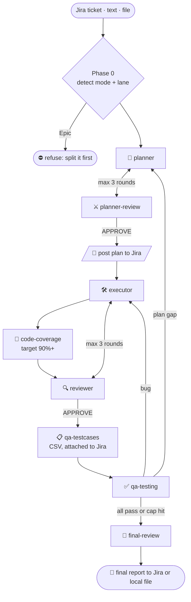

<div align="center">

# 🔁 jira-loop

### Turn a Jira ticket, a sentence, or a spec file into planned, tested, reviewed, and QA'd code, using one Claude Code command.

**8 specialist AI agents · adversarial review loops · 90%+ coverage target · honest final reports**


```text
/jira-loop PROJ-123
/jira-loop --text "the search endpoint 500s when the query is empty" --type bug
/jira-loop --file specs/export-cap.md
```

[Quick start](#-quick-start) · [Playground](docs/PLAYGROUND.md) · [How it works](#-how-it-works) · [Sample output](examples/sample-output/) · [FAQ](#-faq)

</div>

---

## Why this exists

Asking an AI to "implement this ticket" in one prompt tends to fail in the
same ways: the requirement gets misread, edge cases are skipped, nobody
reviews the plan, tests are an afterthought, and the model reports "done" on
work that isn't.

**jira-loop splits the job into the roles a real team uses and makes them
check each other:**

- 🧠 A **planner** writes the plan, and a separate **plan reviewer** tries to break it before any code is written.
- 🛠️ An **executor** implements the plan, and a **coverage agent** writes tests until changed code reaches 90%+.
- 🔍 A **reviewer** checks the result against the *original requirement*, not against the plan.
- ✅ A **QA agent** writes a test sheet from the requirement, another executes it, and each failure is routed to the right fix: a code bug goes back to the executor, a plan gap goes back to the planner.
- 📋 A **final reviewer** writes the closing report, including anything that didn't go well.

Every loop is **capped at 3 rounds**. When a cap is hit, the run continues,
and the final report states what is still unresolved. It won't mark
unfinished work as done.

---

## ✨ Features

| | |
|---|---|
| 🎫 **Three ways in** | A Jira ticket key, an inline `--text` description, or a `--file` spec (`.md` / `.txt`). Jira is optional. |
| 🧭 **Ticket-type aware** | Bugs get root-cause analysis and regression tests. Stories get acceptance-criteria tracing. Tasks get a verifiable definition of done. The type is detected automatically. |
| ⚔️ **Adversarial loops** | planner ⇄ plan-reviewer, executor ⇄ reviewer, QA ⇄ executor/planner. Each capped at 3 rounds. |
| 📊 **Traceable QA** | A CSV test sheet in which every acceptance criterion or DoD item maps to a case via a `Ref` column. It's attached to the ticket automatically. |
| 🧾 **Audit trail** | Every agent's output is saved to `.jira-loop/<KEY>/` or `.dev-loop/LOCAL-<ts>/`. You can see who decided what, and why. |
| 🛡️ **Guardrails** | Refuses Epics. Pulls in the parent of a sub-task. Stops on a missing spec file instead of guessing. Never overwrites your files on install. |
| 🌐 **Any stack** | Coverage and QA agents detect your language and test framework. Nothing is hard-coded. |
| 📦 **Zero dependencies** | Plain Markdown agents and a stdlib-only Python Jira client. Copy one folder and it works. |

---

## 🚀 Quick start

**Requirements:** [Claude Code](https://docs.anthropic.com/en/docs/claude-code), `python3` 3.9+, and optionally a Jira API token.

```bash
# 1. Get it
git clone https://github.com/<your-username>/jira-dev-loop.git

# 2. Install into any project (only adds jira-* files, never overwrites yours)
./jira-dev-loop/install.sh /path/to/your-project

# 3. Run it, no Jira needed
cd /path/to/your-project && claude
```

```text
> /jira-loop --text "Add a /health endpoint that returns 200 and the app version"
```

That's the whole setup for local mode. For Jira mode, see [Connecting Jira](#-connecting-jira).

> [!TIP]
> **New here? Try the [15-minute Playground](docs/PLAYGROUND.md) first.** It
> includes a small shopping-cart app with a planted bug, a feature request and
> a refactor task, so you can watch all three lanes run before touching your
> own code.

---

## 🎮 Three ways to run it

### 1. Inline text: quickest

```text
/jira-loop --text "Users on the free plan can export unlimited CSVs; cap it at 5/day and show a paywall after that."
/jira-loop --text "the search endpoint 500s when the query string is empty" --type bug
```

With no `--type`, the planner decides **BUG / STORY / TASK** itself and
explains its choice on the first line of the plan.
→ [More prompts to try](examples/inline-text.md)

### 2. A `.md` or `.txt` file: for real specs

```text
/jira-loop --file specs/export-cap-spec.md
/jira-loop --file notes/bug-report.txt --type bug
```

Useful for PRDs, pasted bug reports and meeting notes. Only `.md` and `.txt`
are accepted, and a wrong path stops the run instead of being guessed at.
→ [Example specs](examples/specs/)

### 3. A Jira ticket: full round trip

```text
/jira-loop PROJ-123
```

Pulls the ticket (and its parent, if it's a sub-task), then posts the
**plan** as a comment, attaches the **QA sheet**, and posts a **final
report**, all on the ticket.
→ [Practice tickets to create](examples/jira-tickets.md)

|  | `--text` | `--file` | Jira key |
|---|:-:|:-:|:-:|
| Needs Jira credentials | ❌ | ❌ | ✅ |
| Posts back to a ticket | ❌ | ❌ | ✅ |
| Full pipeline, loops and caps | ✅ | ✅ | ✅ |
| Output folder | `.dev-loop/LOCAL-<ts>/` | `.dev-loop/LOCAL-<ts>/` | `.jira-loop/<KEY>/` |

> Ran locally and created a ticket afterward? Post the existing results
> without rerunning:
> `python3 .claude/scripts/jira_client.py comment PROJ-42 --file .dev-loop/LOCAL-<ts>/final-comment.md`

---

## 🧩 How it works



### The 8 agents

| Agent | Role | Writes code? |
|---|---|:-:|
| `jira-planner` | Designs the implementation: approach, reliability, performance, edge cases, file-level changes | ❌ |
| `jira-planner-review` | Adversarial review: over-engineering, missed edge cases, scale risks | ❌ |
| `jira-executor` | Implements the agreed plan and applies targeted fix requests | ✅ |
| `jira-code-coverage` | Writes unit tests until changed code has 90%+ coverage, using your existing framework | ✅ tests |
| `jira-reviewer` | Checks the implementation against the *actual requirement*: under-delivery, scope creep, quality | ❌ |
| `jira-qa-testcases` | Writes the QA sheet from the requirement, not from the code | ❌ |
| `jira-qa-testing` | Runs the sheet, marks pass/fail, classifies each failure as a *bug* or a *plan gap* | ❌ |
| `jira-final-review` | Writes the closing report | ❌ |

### Lanes: the ticket type changes the pipeline's behavior

| Issue type | Lane | Planner must produce | QA sheet is built from |
|---|---|---|---|
| Bug, Defect, Incident | 🐞 **BUG** | `ROOT_CAUSE` + blast radius, smallest fix | The original repro (P0) + regression cases |
| Story, Improvement, Enhancement | 📖 **STORY** | `ACCEPTANCE_CRITERIA`, each mapped to a plan step | At least one case per AC, traced by `Ref` |
| Task, Sub-task, Chore | 🔧 **TASK** | `DEFINITION_OF_DONE`, each item verifiable | One Verification case per DoD item |
| Epic | ⛔ | *Refused. Split into Stories/Tasks first* | — |

Anything unrecognized falls back to TASK. Sub-tasks automatically pull their
parent ticket for context.

---

## 📄 What you get

Every run leaves a readable trail:

```
.jira-loop/PROJ-123/                 (or .dev-loop/LOCAL-20260925-143012/)
├── plan-round-1.md      review-round-1.md      plan-final.md
├── executor-1.md        coverage-1.md          reviewer-round-1.md
└── final-comment.md
qa/PROJ-123-test-cases.csv
```

The final report follows a fixed structure. An abridged example from the
[playground bug](examples/sample-output/final-comment.md):

```markdown
## Summary
An order with a subtotal of exactly $100.00 was not receiving the advertised
"$100 or more" 10% bulk discount.

## Plan
Minimal root-cause fix, approved by planner-review in round 1 of 3.
Root cause: `>` instead of `>=` in `Cart.discount()`.

## QA Results
7 / 7 passed (4 × P0, 3 × P1).
- Original reproduction case (TC-01): PASS. $100.00 now totals $90.00.
- All regression cases around the fix: PASS.

## Deviations & Follow-ups
- No retry cap was hit.
- Follow-up needed (out of scope): float arithmetic can still miss the
  threshold (5 × $19.99 + $0.05 = 99.99999999999999).

## Status
Ready for PR
```

→ See the full [plan](examples/sample-output/plan-final.md), [QA sheet](examples/sample-output/qa-test-cases.csv) and [final report](examples/sample-output/final-comment.md).

---

## 🔌 Connecting Jira

Only needed for ticket mode.

```bash
cd /path/to/your-project
cp .claude/jira-loop.env.example .claude/jira-loop.env
```

| Variable | Value |
|---|---|
| `JIRA_BASE_URL` | `https://yourcompany.atlassian.net` |
| `JIRA_EMAIL` | The account the token belongs to |
| `JIRA_API_TOKEN` | Create one [here](https://id.atlassian.com/manage-profile/security/api-tokens) |
| `JIRA_API_VERSION` | `3` for Jira Cloud (default), `2` for Server / Data Center |
| `JIRA_ACCEPTANCE_CRITERIA_FIELD` | *Optional.* Custom field id (e.g. `customfield_10014`) if your project stores AC in a dedicated field |

Then check it:

```bash
git check-ignore -v .claude/jira-loop.env           # must match, so the token is never committed
python3 .claude/scripts/jira_client.py env-check
python3 .claude/scripts/jira_client.py get PROJ-123 # should print the ticket as JSON
```

The token account needs permission to **view**, **comment on** and **attach
to** issues. In Jira these are separate permissions.

---

## 📦 Installation details

`install.sh` is safe to run on any project, including one that already has a
`.claude/` folder full of its own agents, commands and settings:

- ➕ Only **adds** the `jira-*` agents, `jira-loop.md`, `jira_client.py` and `jira-loop.env.example`.
- 🔒 **Never overwrites** a file with different content. It lists the conflicts and exits non-zero so you can merge by hand.
- 🔑 **Never touches** an existing `.claude/jira-loop.env`.
- 🧷 **Merges** the `jira-loop.env` ignore rule into `.claude/.gitignore` instead of replacing it.
- ♻️ **Idempotent.** Re-running reports "already present" and changes nothing.

Install it once per project; there's no global install.

<details>
<summary><b>Repository layout</b></summary>

```
.claude/
  agents/            8 specialist agents (plain Markdown prompts)
  commands/
    jira-loop.md     the orchestrator, i.e. the /jira-loop command
  scripts/
    jira_client.py   stdlib-only Jira REST client (Cloud ADF + Server plain text)
  jira-loop.env.example
  .gitignore         keeps jira-loop.env out of git
install.sh           safe, idempotent installer
docs/
  PLAYGROUND.md      15-minute hands-on guide to all three modes
examples/
  playground-app/    a small cart app with a planted bug, story and task
  specs/             ready-to-use .md / .txt specs for --file
  inline-text.md     prompts to try with --text
  jira-tickets.md    practice tickets to create in Jira
  sample-output/     what a finished run looks like
```

</details>

---

## ❓ FAQ

<details>
<summary><b>Do I need Jira?</b></summary>

No. `--text` and `--file` run the full pipeline with no credentials and post
nothing anywhere. Jira mode adds the round trip to a ticket.
</details>

<details>
<summary><b>How long does a run take, and what does it cost?</b></summary>

A run makes at least 8 agent calls, and more when review or QA loops retry,
so it takes longer and uses more tokens than a single prompt. Start with small,
well-scoped tickets. The [playground](docs/PLAYGROUND.md) specs are sized for
learning.
</details>

<details>
<summary><b>Will it push, merge, or open PRs?</b></summary>

The pipeline has no commit, push or PR step. It edits your working tree and,
in ticket mode, writes to Jira. Reviewing the diff, committing and opening the
PR are left to you. Run it on a clean branch so `git diff` shows exactly what
changed.
</details>

<details>
<summary><b>What happens if I interrupt it?</b></summary>

Everything already written to disk or posted to Jira stays. The trail folder
shows how far it got. Rerunning starts a fresh pass rather than resuming.
</details>

<details>
<summary><b>What happens when a loop hits its 3-round cap?</b></summary>

The run continues without stopping to ask. The unresolved points go into the
final report, and the status becomes **Needs manual follow-up**. The cap is
never hidden.
</details>

<details>
<summary><b>Can I customize the agents?</b></summary>

Yes. Each agent is a Markdown file in `.claude/agents/`, so edit the prompt to
match your team's standards (coverage target, review checklist, QA format).
Each file has separate BUG / STORY / TASK sections.
</details>

---

## 🧯 Troubleshooting

| Symptom | Fix |
|---|---|
| `Missing required env vars` | `.claude/jira-loop.env` is missing or incomplete. See [Connecting Jira](#-connecting-jira). |
| `Jira API error 401` / `403` | The token is wrong or expired, or the account lacks view, comment or attach permission on that project. |
| `Jira API error 404` on `get` | Wrong `JIRA_BASE_URL`, or the ticket isn't visible to that account. |
| Comments look like broken markup | You're on Server/Data Center. Set `JIRA_API_VERSION=2`. |
| `/jira-loop` not recognized | Launch Claude Code from the *target project's* root, not from this repo. |
| `install.sh` reports CONFLICTS | You already have a file with that name. Diff it against this repo's version and merge by hand. |

---

## 🤝 Contributing

Issues and PRs are welcome, especially:
- agent prompt improvements, with a before/after run showing the difference
- new example specs for the playground
- support for other trackers (Linear, GitHub Issues, GitLab)

See [CONTRIBUTING.md](CONTRIBUTING.md).

---

<div align="center">

**If jira-loop saved you a ticket's worth of work, a ⭐ helps other people find it.**

MIT © jira-loop contributors

</div>
